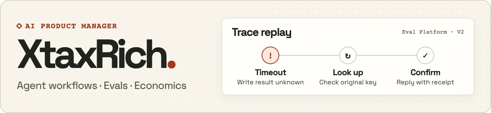

<picture>
  <source media="(max-width: 640px) and (prefers-color-scheme: dark)" srcset="./media/profile-trace-compact-dark.webp">
  <source media="(max-width: 640px)" srcset="./media/profile-trace-compact-light.webp">
  <source media="(prefers-color-scheme: dark)" srcset="./media/profile-trace-dark.webp">
  
</picture>

**AI 产品经理，关注 Agent 工作流、评测和成本。** 我关心一次任务在哪里出错、用户怎样恢复，以及成功交付一次要花多少钱。

## Agent Eval Platform

用同一组任务比较房产 Agent 版本，回放失败发生的步骤。前端演示中的**改约请求超时**案例里，后台已经写入，用户还在等一个确定答复。

- **V0** 换了幂等键重试，被版本校验拦下，随后在缺少回执时告诉用户已改约。
- **V2** 用原幂等键查操作账本，回读订单状态，再用操作回执确认结果。

放量前，我会用同一组任务比较**有回执的成功率、重复写入率和每次成功交付的成本**。最后一项计入模型、工具、重试和人工对单。

[看回放界面](https://github.com/Xaxrich/eval-platform/blob/28057761677d98aeacbde14a7fbd77701745431a/docs/screenshots/04-%E5%9B%9E%E5%BD%92%E5%AF%B9%E6%AF%94-trace%E5%9B%9E%E6%94%BE.png) · [读回放数据](https://github.com/Xaxrich/eval-platform/blob/28057761677d98aeacbde14a7fbd77701745431a/src/data/traces.ts) · [评测平台源码 ↗](https://github.com/Xaxrich/eval-platform)

## More work

**[Claude Code Mini ↗](https://github.com/Xaxrich/claude-code-mini)** · 五文件教学实现 把模型决策、权限检查、工具执行和结果回填拆开看。设计智能体的自主权时，我会先把读取、生成待确认的提案和实际写入分开，各自定义权限。

**[AI Cost Dashboard ↗](https://github.com/Xaxrich/ai-cost-dashboard)** · 订阅支出报告原型 先用手动填报验证一份报告能否帮开发者决定哪项订阅值得续费。等到有人愿意据此调整订阅、下个月也愿意再用，再判断是否值得投入做账单接入。

<strong>更多实验 / More experiments</strong>

- [Research Cleaning Harness](https://github.com/Xaxrich/research-cleaning-harness) 把框架调研整理成出处可查的开发参考。
- [SharkBase](https://github.com/Xaxrich/sharkbase) 把视频知识组织成能力地图和实践任务。
- [CCMADF](https://github.com/Xaxrich/ccmadf) 探索多智能体开发流程。
- [OKX AI Quant Lab](https://github.com/Xaxrich/okx-ai-quant-lab) 探索多源量化研究、风险边界与审计。
- [Mahjong Visual Guide](https://github.com/Xaxrich/mahjong-visual-guide) 交互式教学和可视化实验。

<strong>English overview</strong>

I’m XtaxRich, an AI product manager focused on agent workflows, evaluation, and cost per successful task. My agent eval demo compares how two versions handle a write timeout. The second checks the original operation and verifies the order before confirming it to the user. I’d evaluate verified completion, duplicate writes, and total cost per completed task together.

I also build small prototypes to examine how agents use tools and when an AI expense report can change a subscription decision. I welcome conversations about product roles in agent platforms and applied AI.

欢迎交流 Agent 平台和 AI 应用的产品机会。[查看全部仓库 ↗](https://github.com/Xaxrich?tab=repositories)
